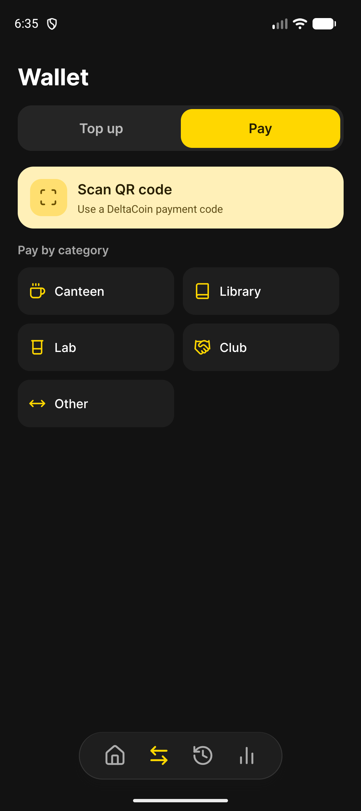
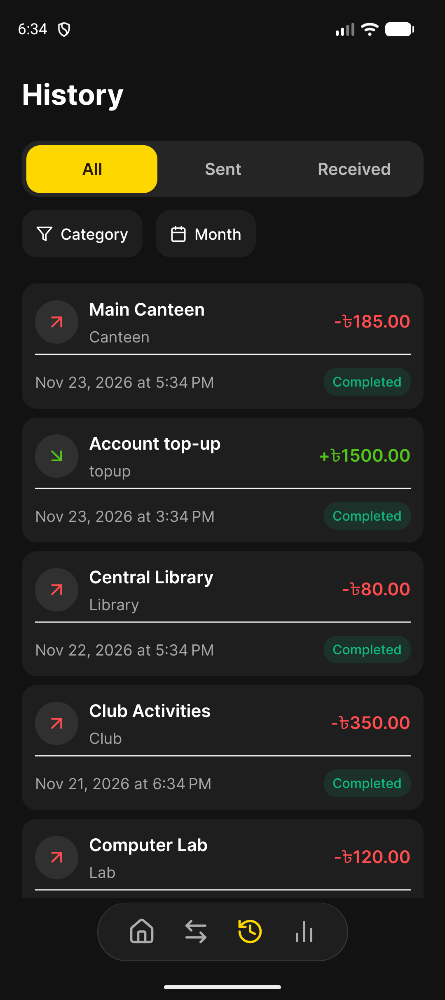
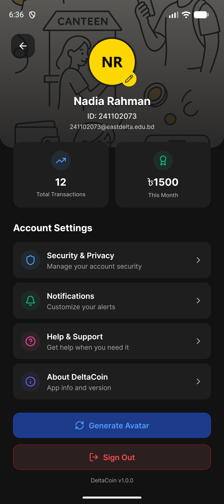

<p align="center">
  
</p>

<h1 align="center">DeltaCoin Mobile</h1>

<p align="center">A student project that demonstrates a digital campus wallet.</p>

<p align="center">
  
  <a href="#run-locally"></a>
  
  
  <a href="LICENSE"></a>
</p>

## Screenshots

Android screenshots captured with a fictional student profile and demo transactions.

| Home | Wallet | History |
| --- | --- | --- |
|  |  |  |

| Insights | Notifications | Profile |
| --- | --- | --- |
|  |  |  |

## Features

- **Student accounts** use Supabase Auth for email sign-in. The profile shows student details, recent account statistics, and a shortcut to edit personal information.
- **Campus wallet** shows the available balance, monthly spending, and recent activity on Home. To pay, scan a DeltaCoin QR code or choose a campus category, review the amount, and confirm with your PIN.
- **Top-ups** support simulated bank and mobile banking flows. A configured Stripe integration lets you exercise the card flow in test mode.
- **Transaction history** shows incoming and outgoing activity with amounts and statuses. Combine month and category filters, and see updates while History is open when Realtime is enabled on the backend.
- **Spending insights** show monthly totals and a category breakdown. Set category budgets, compare actual spending with your limits, and share a PDF report.
- **Friends and notifications** let students find classmates, respond to friend requests, and send or request demo funds. The inbox groups recent activity by date and lets you filter and mark unread alerts.

## Architecture

| Area | Implementation |
| --- | --- |
| App and navigation | [`app/`](app/) contains TypeScript screens and Expo Router layouts. The root stack handles authentication and standalone screens, while the floating tab bar connects Home, Wallet, History, and Insights. |
| UI and device features | [`components/`](components/) contains reusable forms, payment inputs, and animated controls. Expo Camera scans payment QR codes, and Expo Print and Sharing generate and share PDF reports. |
| Data and payments | [`supabase/`](supabase/) contains the client and helpers for Supabase Auth, Postgres, and Storage. The app reads and writes demo wallet data through these helpers. History subscribes to transaction changes through Supabase Realtime, and the Stripe helper connects the card flow to a configured payment-intent endpoint. |

## Run locally

1. Install Node.js 22.13+, 24.3+, or 26+, then run `npm ci`.
2. Add the credentials for your configured Supabase project to a local `.env` file.

   ```dotenv
   EXPO_PUBLIC_SUPABASE_URL=https://your-project.supabase.co
   EXPO_PUBLIC_SUPABASE_ANON_KEY=your_publishable_key
   ```

3. Run `npm run dev` and scan the terminal QR code with [Expo Go for Android](https://expo.dev/go?device=true&platform=android&sdkVersion=58).

## License

DeltaCoin Mobile is available under the [MIT License](LICENSE).
