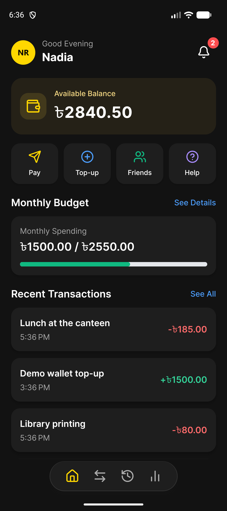
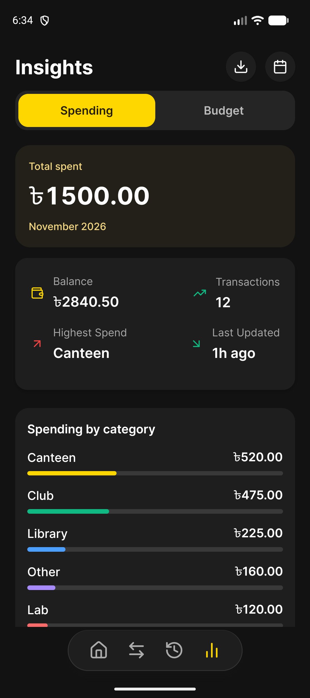
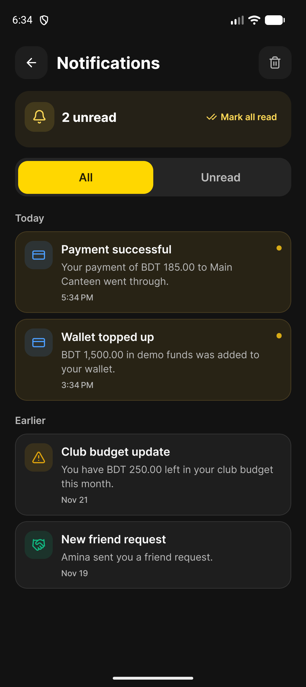

<p align="center">
  
</p>

<h1 align="center">DeltaCoin Mobile</h1>

<p align="center">A student project that demonstrates a digital campus wallet.</p>

<p align="center">React Native &middot; Expo SDK 58 &middot; Supabase &middot; <a href="LICENSE">MIT</a></p>

## Screenshots

Android screenshots captured with a fictional student profile and demo transactions.

| Home | Wallet | History |
| --- | --- | --- |
|  |  |  |

| Insights | Notifications | Profile |
| --- | --- | --- |
|  |  |  |

## Features

- **Campus wallet** shows your balance and recent activity. Make a campus payment by scanning a DeltaCoin QR code or choosing a category such as Canteen or Library.
- **Top-ups** offer simulated bank and mobile banking flows, plus a Stripe card flow for testing when configured.
- **Transaction history** shows incoming and outgoing activity, with category and month filters and live updates through Supabase Realtime.
- **Spending insights** break down monthly expenses by category, track budget progress, and export a PDF report.
- **Friends and notifications** let students connect, send or request demo funds, and follow account activity in the in-app inbox.

## Run locally

1. Install Node.js 22.13+, 24.3+, or 26+, then run `npm ci`.
2. Add the credentials for your configured Supabase project to a local `.env` file.

   ```dotenv
   EXPO_PUBLIC_SUPABASE_URL=https://your-project.supabase.co
   EXPO_PUBLIC_SUPABASE_ANON_KEY=your_publishable_key
   ```

3. Run `npm run dev` and scan the terminal QR code with [Expo Go for Android](https://expo.dev/go?device=true&platform=android&sdkVersion=58).

## License

DeltaCoin Mobile is available under the [MIT License](LICENSE).
